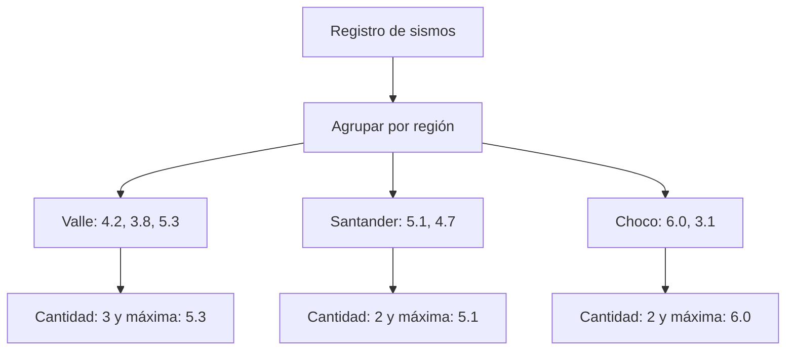
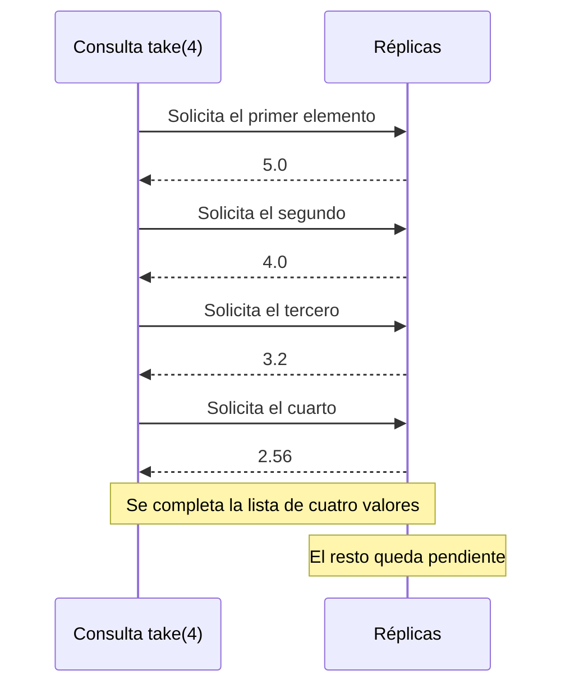
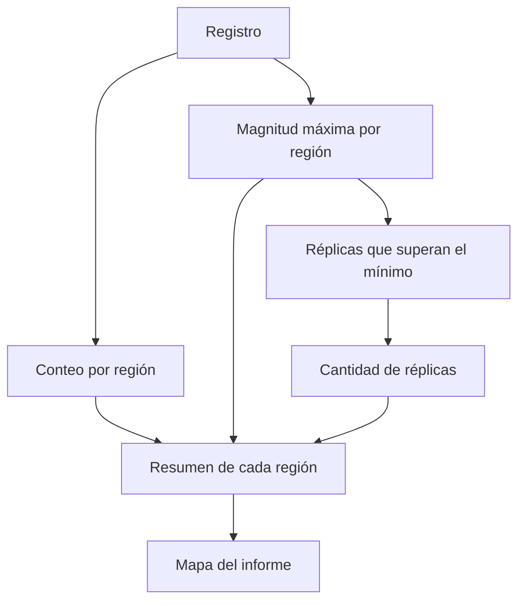

En este taller trabajamos con una lista de sismos. Cada uno tiene fecha,
región, magnitud y profundidad. Las consultas permiten buscar eventos,
agruparlos y preparar un resumen de lo ocurrido en cada lugar.

Los ejemplos de este informe usan el registro del enunciado. Para seguir
las consultas, estos son sus datos de región y magnitud:

| Posición | Región | Magnitud |
|---|---|---|
| 1 | Valle | 4.2 |
| 2 | Santander | 5.1 |
| 3 | Valle | 3.8 |
| 4 | Choco | 6.0 |
| 5 | Santander | 4.7 |
| 6 | Valle | 5.3 |
| 7 | Choco | 3.1 |

## 1. Consultas con `for`

Las tres funciones de este punto usan `for` con `yield`.

La parte que está dentro del `for` indica qué elementos se revisan y qué
condiciones deben cumplir. Después, `yield` señala qué se guarda en la
lista de respuesta.

### 1.1. `fuertes`

```scala
def fuertes(r: Registro, umbral: Double): List[String] =
  for {
    sismo <- r
    if sismo.magnitud > umbral
  } yield sismo.region
```

`r` contiene los sismos y `umbral` es el valor que deben superar.

Para `fuertes(registro, 5.0)`, el recorrido es:

| Región | Magnitud | ¿Supera 5.0? | Se agrega |
|---|---|---|---|
| Valle | 4.2 | No | Nada |
| Santander | 5.1 | Sí | Santander |
| Valle | 3.8 | No | Nada |
| Choco | 6.0 | Sí | Choco |
| Santander | 4.7 | No | Nada |
| Valle | 5.3 | Sí | Valle |
| Choco | 3.1 | No | Nada |

El resultado es:

```scala
List("Santander", "Choco", "Valle")
```

La comparación usa `>`. Por eso, una magnitud igual al umbral queda fuera.
Las regiones mantienen su orden de aparición y pueden salir varias veces
si tienen varios sismos que cumplen la condición.

Con un registro vacío, devuelve `List()`.

#### En qué se traduce el `for`

Esta expresión equivale a:

```scala
r.withFilter(sismo => sismo.magnitud > umbral)
  .map(sismo => sismo.region)
```

`withFilter` deja pasar los elementos que cumplen la condición cuando
se recorre la lista. Luego, `map` obtiene la región de cada uno.

Esta forma explica el funcionamiento del `for`; la solución del punto
conserva la expresión que pide el enunciado.

### 1.2. `enRegion`

```scala
def enRegion(r: Registro, region: String): List[Double] =
  for {
    sismo <- r
    if sismo.region == region
  } yield sismo.magnitud
```

La consulta revisa los eventos y conserva únicamente los que pertenecen
a la región solicitada. De cada uno toma su magnitud.

Para `enRegion(registro, "Valle")`:

1. Encuentra el primer sismo de Valle y guarda `4.2`.
2. Omite Santander.
3. Agrega `3.8`.
4. Descarta los siguientes eventos de otras regiones.
5. Incluye `5.3`.

La respuesta queda:

```scala
List(4.2, 3.8, 5.3)
```

Si no encuentra esa región, entrega una lista vacía.

#### En qué se traduce el `for`

```scala
r.withFilter(sismo => sismo.region == region)
  .map(sismo => sismo.magnitud)
```

La condición selecciona la región. Después, `map` recoge las magnitudes
sin alterar el orden de los eventos.

### 1.3. `paresCercanos`

```scala
def paresCercanos(r: Registro, dif: Double): List[(String, String)] = {
  val regiones = r.map(s => s.region).distinct

  (for {
    region1 <- regiones
    region2 <- regiones
    if regiones.indexOf(region1) < regiones.indexOf(region2)
    sismo1 <- r
    sismo2 <- r
    if sismo1.region == region1
    if sismo2.region == region2
    if math.abs(sismo1.magnitud - sismo2.magnitud) <= dif
  } yield (region1, region2)).distinct
}
```

Primero se obtienen los nombres de las regiones:

```scala
List("Valle", "Santander", "Valle", "Choco", "Santander", "Valle", "Choco")
```

El primer `distinct` quita los nombres repetidos y conserva su primera
aparición:

```scala
List("Valle", "Santander", "Choco")
```

Luego se buscan parejas:

1. `region1` toma una región.
2. `region2` considera las opciones de la misma lista.
3. La comparación de posiciones permite únicamente aquellas donde
   `region1` aparece antes que `region2`.
4. Se revisan los sismos de ambas.
5. Se calcula la diferencia entre sus magnitudes con `math.abs`.
6. Si esa distancia no supera `dif`, se produce la pareja.
7. El último `distinct` deja una sola aparición de cada resultado.

La comparación de posiciones evita unir una región consigo misma.
También impide obtener una pareja y luego la misma al revés.

Con una diferencia de `0.6`, Valle y Santander cumplen la condición.
Por ejemplo, sus magnitudes `5.3` y `5.1` están separadas por
aproximadamente `0.2`.

Aunque otros eventos de esas regiones también sean cercanos, la respuesta
solo incluye una vez la pareja:

```scala
paresCercanos(registro, 0.6)
// List(("Valle", "Santander"))
```

#### En qué se traduce el `for`

La expresión equivale a:

```scala
regiones.flatMap(region1 =>
  regiones
    .withFilter(region2 =>
      regiones.indexOf(region1) < regiones.indexOf(region2)
    )
    .flatMap(region2 =>
      r.flatMap(sismo1 =>
        r
          .withFilter(sismo2 => sismo1.region == region1)
          .withFilter(sismo2 => sismo2.region == region2)
          .withFilter(sismo2 =>
            math.abs(sismo1.magnitud - sismo2.magnitud) <= dif
          )
          .map(sismo2 => (region1, region2))
      )
    )
).distinct
```

Cada `flatMap` combina los resultados del siguiente recorrido en una
sola lista. Los `withFilter` corresponden a las condiciones del `for`.
El último `map` forma la pareja indicada por `yield`.

Los dos `distinct` cumplen tareas diferentes: el primero evita repetir
regiones al buscarlas y el último elimina parejas que se encontraron
con varios sismos.

## 2. Agrupación por región

### 2.1. `porRegion`

```scala
def porRegion(r: Registro): Map[String, List[Sismo]] =
  r.groupBy(s => s.region)
```

`groupBy` toma la región de cada sismo y la usa como nombre de su grupo.

En el registro del ejemplo:

| Región | Magnitudes de los sismos agrupados |
|---|---|
| Valle | 4.2, 3.8, 5.3 |
| Santander | 5.1, 4.7 |
| Choco | 6.0, 3.1 |

La tabla muestra solo las magnitudes para facilitar la lectura. El mapa
guarda los sismos completos, con su fecha y profundidad.

Los eventos de una misma región conservan el orden que tenían en la
lista original. Las regiones ausentes no se agregan al mapa.

Si el registro está vacío, devuelve `Map()`.

### 2.2. `conteoPorRegion`

```scala
def conteoPorRegion(r: Registro): Map[String, Int] = {
  val regiones = porRegion(r)

  regiones.map { case (region, sismos) =>
    region -> sismos.length
  }
}
```

El proceso tiene tres pasos:

1. Agrupa los sismos mediante `porRegion`.
2. Obtiene el tamaño de cada lista con `length`.
3. Asocia el nombre de la región con esa cantidad.

Para el ejemplo:

```scala
Map("Valle" -> 3, "Santander" -> 2, "Choco" -> 2)
```

El orden en que se muestran las entradas del mapa puede variar. Lo que
se conserva es la cantidad asociada a cada nombre.

### 2.3. `magnitudMaxima`

```scala
def magnitudMaxima(r: Registro): Map[String, Double] = {
  val regiones = porRegion(r)

  regiones.map { case (region, sismos) =>
    region -> sismos.map(s => s.magnitud).max
  }
}
```

Primero reúne los eventos por región. Dentro de cada grupo, `map`
obtiene las magnitudes y `max` elige la mayor.

Para Valle:

```text
Sismos de Valle
    → List(4.2, 3.8, 5.3)
    → 5.3
```

Al hacer lo mismo con las demás regiones, queda:

```scala
Map("Valle" -> 5.3, "Santander" -> 5.1, "Choco" -> 6.0)
```

Cada grupo creado por `groupBy` tiene al menos un sismo, así que `max`
no recibe una lista vacía. Si el registro no tiene eventos, no hay
grupos que revisar y se obtiene `Map()`.

### Diagrama de agrupación



## 3. Consultas seguras

### 3.1. `conteoSeguro`

```scala
def conteoSeguro(r: Registro): Map[String, Int] =
  conteoPorRegion(r).withDefaultValue(0)
```

La función calcula las cantidades del punto anterior y establece cero
como respuesta para un nombre que no esté en el mapa.

```scala
conteoSeguro(registro)("Valle")
// 3

conteoSeguro(registro)("Amazonas")
// 0
```

Consultar Amazonas no agrega una entrada nueva. El cero es la respuesta
que se obtiene al buscar con paréntesis una región desconocida.

### 3.2. `maximaDe`

```scala
def maximaDe(r: Registro, region: String): Option[Double] = {
  magnitudMaxima(r).get(region)
}
```

Primero se construye el mapa de magnitudes máximas. Después, `get`
busca la región solicitada.

Si encuentra el nombre, devuelve `Some` con su valor:

```scala
maximaDe(registro, "Choco")
// Some(6.0)
```

Cuando no está registrado, responde `None`:

```scala
maximaDe(registro, "Amazonas")
// None
```

Así se distingue entre encontrar una magnitud y no tener datos de
esa región.

### 3.3. `regionMasActiva`

```scala
def regionMasActiva(r: Registro): Option[String] = {
  if (r.isEmpty) None
  else {
    val apoyo = conteoPorRegion(r)

    apoyo.toList.sortBy { case (region, numerodesismos) =>
      (-numerodesismos, region)
    }.headOption.map { case (region, numerodesismos) =>
      region
    }
  }
}
```

Cuando no hay sismos, la respuesta es `None`.

Si existen datos:

1. Se cuenta cuántos eventos tiene cada región.
2. El mapa se convierte en una lista.
3. Se ordena usando la cantidad negativa y el nombre.
4. `headOption` toma la primera entrada.
5. El último `map` conserva únicamente la región.

La cantidad lleva signo negativo para que los conteos mayores queden
primero al ordenar de menor a mayor.

Con el registro del ejemplo, la lista ordenada queda:

```scala
List(("Valle", 3), ("Choco", 2), ("Santander", 2))
```

Choco aparece antes que Santander porque tienen la misma cantidad y
ese nombre va primero alfabéticamente.

La consulta devuelve:

```scala
Some("Valle")
```

## 4. Réplicas

### 4.1. `replicas` y el redondeo

```scala
def replicas(magnitud: Double): LazyList[Double] = {
  val actual = redondear(magnitud)
  actual #:: replicas(magnitud * 0.8)
}
```

El redondeo se calcula con:

```scala
Math.round(x * 100.0) / 100.0
```

Por ejemplo, para `3.392`:

```text
3.392 × 100 = 339.2
Math.round(339.2) = 339
339 / 100.0 = 3.39
```

En `replicas`, `actual` es el valor redondeado que se entrega.
La siguiente magnitud se obtiene multiplicando por `0.8` el dato
recibido, antes de redondearlo.

Por eso, a partir de `5.3`, el proceso sigue así:

| Magnitud usada en el cálculo | Valor entregado |
|---|---|
| 5.3 | 5.3 |
| 4.24 | 4.24 |
| 3.392 | 3.39 |
| 2.7136 | 2.71 |

Los números de la primera columna muestran el cálculo decimal esperado.
En el programa se representan con `Double`.

#### Recorrido de `take(4)`

Para:

```scala
replicas(5.0).take(4).toList
```

se obtienen estos valores:

```text
Primer elemento:  5.0
Segundo elemento: 5.0 × 0.8 = 4.0
Tercer elemento:  4.0 × 0.8 = 3.2
Cuarto elemento:  3.2 × 0.8 = 2.56
```

El resultado es:

```scala
List(5.0, 4.0, 3.2, 2.56)
```

`#::` coloca el primer elemento y deja pendiente la parte que sigue.
La llamada que genera el resto se realiza cuando hace falta avanzar.

#### Diagrama del pedido de cuatro valores



#### Por qué no se calcula toda la secuencia

Una `LazyList` permite obtener elementos a medida que se necesitan.
Aunque la definición pueda continuar, `take(4)` limita el pedido a
cuatro valores.

Por eso no se intenta guardar una lista infinita en memoria. Esto no
significa que cualquier uso consuma poco espacio: los valores calculados
pueden quedar guardados mientras se conserve la lista. Convertir toda
la secuencia infinita con `toList`, sin limitarla, no terminaría.

### 4.2. `replicasSensibles`

```scala
def replicasSensibles(magnitud: Double, minimo: Double): List[Double] = {
  require(minimo >= 0.0, "El mínimo debe ser no negativo")
  replicas(magnitud).takeWhile(_ > minimo).toList
}
```

Primero se comprueba que el mínimo sea mayor o igual a cero.
Después se genera la secuencia del punto anterior.

`takeWhile` conserva los valores desde el inicio mientras superen
el mínimo. Al encontrar uno que no cumple, detiene el recorrido.
Finalmente, `toList` convierte la parte seleccionada en una lista.

Para `replicasSensibles(5.0, 3.0)`:

| Valor revisado | ¿Supera 3.0? | Decisión |
|---|---|---|
| 5.0 | Sí | Conservar |
| 4.0 | Sí | Conservar |
| 3.2 | Sí | Conservar |
| 2.56 | No | Detener |

La respuesta es:

```scala
List(5.0, 4.0, 3.2)
```

Se revisa también `2.56` porque hace falta comprobar dónde detenerse,
pero ese valor no se incluye.

Si la primera magnitud ya es menor o igual al mínimo, el resultado
es `List()`.

## 5. Informe combinado

```scala
def informe(r: Registro, minimo: Double): Map[String, Resumen] = {
  val conteos = conteoPorRegion(r)
  val maximas = magnitudMaxima(r)

  maximas.map {
    case (region, maxima) =>
      val cantidad = conteos(region)
      val cantidadReplicas = replicasSensibles(maxima, minimo).length

      region -> Resumen(cantidad, maxima, cantidadReplicas)
  }
}
```

Esta función reúne los resultados anteriores:

1. `conteos` guarda cuántos sismos tiene cada región.
2. `maximas` contiene la mayor magnitud de cada grupo.
3. Para cada entrada de `maximas`, se consulta su cantidad de eventos.
4. Se calculan las réplicas sensibles de esa magnitud máxima.
5. `length` cuenta los valores obtenidos.
6. Los tres datos se guardan en un `Resumen`.

Con un mínimo de `3.0`:

| Región | Sismos | Máxima | Réplicas que superan 3.0 | Cantidad |
|---|---|---|---|---|
| Valle | 3 | 5.3 | 5.3, 4.24, 3.39 | 3 |
| Santander | 2 | 5.1 | 5.1, 4.08, 3.26 | 3 |
| Choco | 2 | 6.0 | 6.0, 4.8, 3.84, 3.07 | 4 |

La respuesta queda:

```scala
Map(
  "Valle" -> Resumen(3, 5.3, 3),
  "Santander" -> Resumen(2, 5.1, 3),
  "Choco" -> Resumen(2, 6.0, 4)
)
```

Cada región de `maximas` también existe en `conteos`, porque ambos
mapas se construyen a partir del mismo registro.

Con una entrada vacía, los dos mapas están vacíos y el informe devuelve
`Map()`.

### Diagrama del informe

